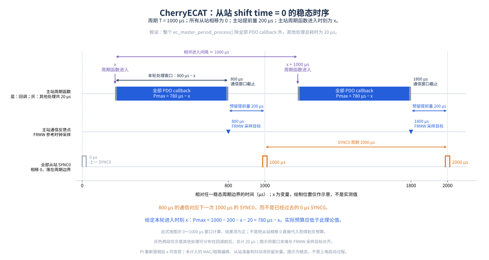

快速入门
===========================

本节主要介绍如何使用 CherryECAT。当前我们推荐在以下开发板中使用 CherryECAT。

- HPMicro 系列开发板
- RT-Thread Titan、 etherkit、RuiQing 开发板

ethercat 命令行
-----------------

我们提供了一个简单的命令行工具 `ethercat` 用于测试 CherryECAT 功能。为了方便使用过 IgH 的 linux 用户过渡，格式部分参考的是 IgH。

- **ethercat start**: 启动主站 PDO 定时器，切换所有 slaves 到 OP 状态，后续参数依次为主站定时器周期（单位微秒）和 CIA402 模式（可选，默认为 0），支持的 CIA402 模式有：

.. code-block:: c
   :linenos:

    #define EC_CIA402_OPERATION_MODE_NO_MODE 0x00
    #define EC_CIA402_OPERATION_MODE_CSP     0x01
    #define EC_CIA402_OPERATION_MODE_CSV     0x02
    #define EC_CIA402_OPERATION_MODE_CSP_CSV 0x03
    #define EC_CIA402_OPERATION_MODE_CST     0x04
    #define EC_CIA402_OPERATION_MODE_HOME    0x05

- **ethercat stop**: 停止主站 PDO 定时器，切换所有 slaves 到 PREOP 状态
- **ethercat master**: 用于查看主站状态，数据统计等信息
- **ethercat rescan**: 重新扫描总线
- **ethercat slaves**: 查看从站信息，使用 `-p` 参数选择指定从站，使用 `-v` 参数查看详细信息
- **ethercat pdos**: 查看 PDO 映射信息，使用 `-p` 参数选择指定从站
- **ethercat states**: 请求从站状态转换， 使用 `-p` 参数选择指定从站，状态需要从 `ec_slave_state_t` 枚举中选择并以十六进制输入
- **ethercat pdo_read -p <idx>**: 读取指定从站的输入和输出 PDO 十六进制数据，索引从 0 开始。需先启动主站，命令直接从 PDO 映射地址分别打印输出 RxPDO 和输入 TxPDO，不复制到临时缓冲区。
- **ethercat coe_read**: 通过 CoE 读取 SDO, 使用 `-p` 参数选择指定从站，后续参数依次为 index, subindex, 如果忽略 subindex 则使用 sdo complete 模式
- **ethercat coe_write**: 通过 CoE 写入 SDO，使用 `-p` 参数选择指定从站，后续参数依次为 index, subindex, data，不使用 sdo complete 模式
- **ethercat foe_read**: 通过 FoE 读取文件, 使用 `-p` 参数选择指定从站，后续参数依次为 filename, pwd 和 16进制数组，数组从低位到高位输入
- **ethercat foe_write**: 通过 FoE 写入文件，使用 `-p` 参数选择指定从站，后续参数依次为 filename, pwd 和 16进制数组，数组从低位到高位输入
- **ethercat eoe_start**: 启动 EoE 功能
- **ethercat eoe_stats**: 查看 EoE 统计信息
- **ethercat sii_read**: 读取 SII 数据， 使用 `-p` 参数选择指定从站
- **ethercat sii_write**: 写入 SII 数据， 使用 `-p` 参数选择指定从站
- **ethercat wc**: 查看主站工作计数器
- **ethercat perf**: 性能测试， 使用 `-s` 参数开始，使用 `-v` 参数查看测试结果，使用 `-d` 参数停止测试

典型使用流程
-----------------

- 调用 `ec_master_init` 初始化主站
- 为每个 slave 配置 config 参数，包括 PDO 映射、DC 同步等， `ec_slave_config_t` 结构体定义如下：

.. code-block:: c
   :linenos:

    typedef struct {
        ec_sync_info_t *sync;                           /**< Sync manager configuration. */
        uint8_t sync_count;                             /**< Number of sync managers. */
        ec_pdo_callback_t pdo_callback;                 /**< PDO process data callback. */
        uint16_t dc_assign_activate;                    /**< dc assign control */
        ec_sync_signal_t dc_sync[EC_SYNC_SIGNAL_COUNT]; /**< DC sync signals. */
    } ec_slave_config_t;

    // 举例从协议栈提供的部分 slave 信息中寻找 sync 信息，并进行配置
    for (uint32_t i = 0; i < global_cmd_master->slave_count; i++) {
        ret = ec_master_find_slave_sync_info(global_cmd_master->slaves[i].sii.vendor_id,
                                              global_cmd_master->slaves[i].sii.product_code,
                                              global_cmd_master->slaves[i].sii.revision_number,
                                              motor_mode,
                                              &slave_config[i].sync,
                                              &slave_config[i].sync_count);
        if (ret != 0) {
            EC_LOG_ERR("Failed to find slave sync info: vendor_id=0x%08x, product_code=0x%08x\n",
                        global_cmd_master->slaves[i].sii.vendor_id,
                        global_cmd_master->slaves[i].sii.product_code);
            return -1;
        }

        slave_config[i].dc_assign_activate = 0x300;

        slave_config[i].dc_sync[0].cycle_time = atoi(argv[1]) * 1000;
        slave_config[i].dc_sync[0].shift_time = 0;
        slave_config[i].dc_sync[1].cycle_time = 0;
        slave_config[i].dc_sync[1].shift_time = 0;
        slave_config[i].pdo_callback = ec_pdo_callback;

        global_cmd_master->slaves[i].config = &slave_config[i];
    }

.. note:: 定义的 config 变量需要是全局变量

- 配置主站 master 相关参数，包括 `cycle_time`、 `shift_time`、 `dc_sync_with_dc_ref_enable` 等

  - `cycle_time` 代表主站定时器的周期，单位为纳秒。
  - `shift_time` 代表相对于 cycle_time 的提前时间，单位为纳秒，通常设置为 20% 的 cycle_time。 **主站 PDO 处理需要在这个时间内完成**
  - `dc_sync_with_dc_ref_enable` 代表 DC 同步是与主站时钟同步还是和第一个带有 DC 的从站同步。通常推荐和从站同步。

下图展示了以上参数的关系，和参考从站同步：

- 最后调用 `ec_master_start` 启动周期性传输，如果从站没有扫描就调用则会直接退出。

.. code-block:: c
   :linenos:

        master_config.cycle_time = atoi(argv[2]) * 1000;            // cycle time in ns
        master_config.shift_time = master_config.cycle_time * 0.2f; // master send phase: 20% of a cycle before SYNC0
        master_config.dc_sync_with_dc_ref_enable = true;            // enable DC sync with dc reference clock
        ret = ec_master_start(global_cmd_master, &master_config);

- PDO 数据统一在配置的 ``pdo_callback`` 中处理：从 ``input`` 读取输入，向 ``output`` 写入下一周期的输出，长度分别为 ``slave->idata_size`` 和 ``slave->odata_size``。回调不能阻塞，应用应在回调中读写 PDO。诊断命令 ``pdo_read -p <idx>`` 直接读取 PDO 映射地址，打印期间数据仍可能随通信周期更新。

HPMicro IO 示例
-----------------------

示例支持 HPM IO 从站（VID ``0x0048504D``，PID ``0x00000001`` / ``0x00000002`` / ``0x00000005``）。命令如下：

.. code-block:: text

    ethercat start 1000
    ethercat pdo_read -p 0
    ethercat stop

HPMicro demo 的 ``ec_pdo_callback`` 在 IO 从站处于 OP 时，将 32 位输入值复制到输出，

核心处理如下：

.. code-block:: c

    uint32_t value = EC_READ_U32(input);
    EC_WRITE_U32(output, value);

如果需要测试固定输出，可将 IO 分支的上述处理替换为：

.. code-block:: c

    EC_WRITE_U32(output, 0x00000001U);

重新编译运行后，通过 ``ethercat pdo_read -p 0`` 查看输出区，固定值 1 的字节序列为
``01 00 00 00``。``output`` 为主站发送给从站的数据，``input`` 为从站返回给主站的数据。

HPMicro CIA402 电机示例
-----------------------

示例支持 HPM CIA402 从站（VID ``0x0048504D``，PID ``0x00000003`` / ``0x00000004``），支持 CSV / CSP。

- ``motor_control -p <idx> <0|1>``：关闭或使能电机。命令仅更新 enable 变量。回调在 disable 时直接发送 Disable voltage；enable 时才按状态字依次发送 Shutdown、Switch on、Enable operation，遇到 Fault 时发送一次 Fault reset。关闭时保留速度和位置指令。
- ``speed_control -p <idx> <value>``：设置 CSV 目标速度（0x60FF），支持有符号 32 位整数。
- ``position_control -p <idx> <value>``：设置 CSP 绝对目标位置（0x607A），支持有符号 32 位整数。

HPMicro demo 的 ``ec_pdo_callback`` 里面负责 CIA402 的运行和停止，以及速度，位置更新。

在使用 CSV / CSP 时，需要在 preop 模式下设置 ``0x6060`` 工作模式，8 表示 CSV，9 表示 CSP。使用 ``coe_write`` 写入。完成命令如下：

CSV 示例（``0x6060 = 9``，``ethercat start`` 的模式参数为 2）：

.. code-block:: text

    ethercat coe_write -p 0 6060 00 09
    ethercat start 1000 2
    ethercat coe_read -p 0 6061 00
    motor_control -p 0 1
    speed_control -p 0 100
    ethercat pdo_read -p 0
    speed_control -p 0 0
    motor_control -p 0 0
    ethercat stop

读取的 ``0x6061`` 应为 ``09``。``speed_control`` 设置目标速度，不能代替 ``0x6060`` 的模式设置。

CSP 示例（``0x6060 = 8``，``ethercat start`` 的模式参数为 1）：

.. code-block:: text

    ethercat coe_write -p 0 6060 00 08
    ethercat start 1000 1
    ethercat coe_read -p 0 6061 00
    motor_control -p 0 1
    position_control -p 0 1000
    ethercat pdo_read -p 0
    motor_control -p 0 0
    ethercat stop

读取的 ``0x6061`` 应为 ``08``。切换模式前先关闭电机并执行 ``ethercat stop``，
回到 PREOP 后重新写入 ``0x6060``，再使用对应的模式参数启动通信。
